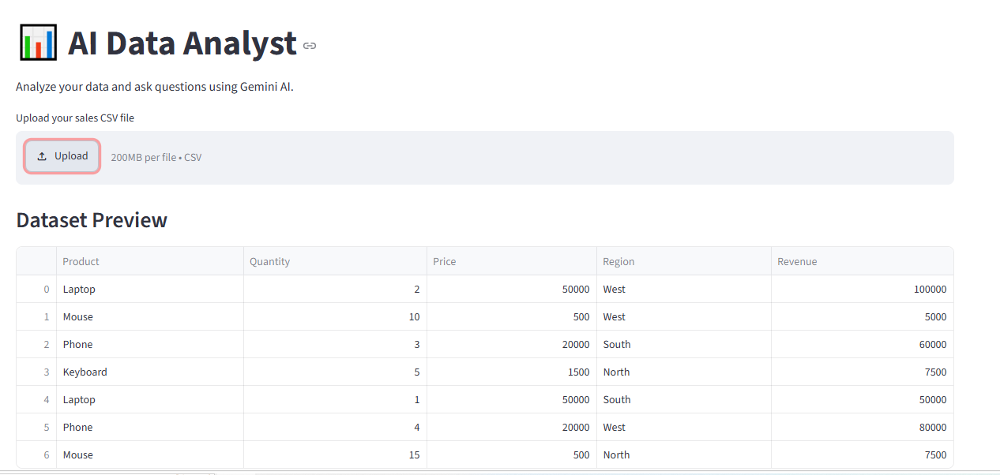

# 🤖 AI Data Analyst Using Python, Streamlit & Gemini AI

An AI-powered data analysis application that helps users explore datasets, analyze sales data, create charts, and generate insights using natural language and Google Gemini AI.

## 📸 Project Screenshot

Add your project screenshot below.




v

*AI Data Analyst Dashboard built using Python, Streamlit, and Gemini AI.*

> **Note:** Save your screenshot in a folder named `screenshots` with the filename `dashboard.png`. If you use a different filename, update the image path above.

## 🚀 Features

- 📂 Upload CSV files for data analysis.
- 📊 Preview uploaded datasets.
- 📈 Generate charts using natural-language requests.
- 🤖 Get AI-powered explanations and business insights using Gemini AI.
- 💰 Calculate total revenue and average price.
- 🏆 Find products with the highest and lowest revenue.
- 🌍 Identify the region with the highest revenue.
- 🔢 Count dataset rows, columns, and unique products.
- 📥 Download the analysis data as a CSV report.

## 🛠️ Technologies Used

- Python
- Pandas
- Streamlit
- Matplotlib
- Seaborn
- Google Gemini API
- Python Dotenv

## 📁 Project Structure

```text
ai_data_analyst/
│
├── app.py
├── test_gemini.py
├── .env
├── .gitignore
├── README.md
└── screenshots/
    └── dashboard.png
```

**Security note:** The `.env` file contains your Gemini API key. Keep it private and do not upload it to GitHub.

## ⚙️ Installation and Setup

### 1. Clone the repository

```bash
git clone YOUR_GITHUB_REPOSITORY_URL
```

### 2. Open the project folder

```bash
cd ai-data-analyst
```

### 3. Install the required libraries

```bash
python -m pip install pandas streamlit matplotlib seaborn google-genai python-dotenv
```

### 4. Configure your Gemini API key

Create a `.env` file in the project folder and add:

```text
GEMINI_API_KEY=your_gemini_api_key
```

Replace `your_gemini_api_key` with your own API key. Never share this key publicly.

### 5. Run the application

```bash
python -m streamlit run app.py
```

The application will open in your browser.

## 💡 Example Questions

You can ask the application questions such as:

- What is the total revenue?
- Which product has the highest revenue?
- Which product has the lowest revenue?
- Which region has the highest revenue?
- What is the average price?
- How many rows and columns are in the dataset?
- How many different products are there?

## 📊 Project Objective

The objective of this project is to simplify data analysis by combining Python data-processing tools with generative AI. Users can explore their data, create visualizations, and understand business insights without needing advanced programming knowledge.

## 👩‍💻 Author

**Vaishali Shinde**

Aspiring Python Data Analyst | Python | Pandas | Data Visualization | Generative AI

## ⭐ Acknowledgement

This project was developed as a hands-on learning project to practice Python, data analysis, visualization, and generative AI integration.

If you find this project useful, please give it a ⭐ on GitHub!
